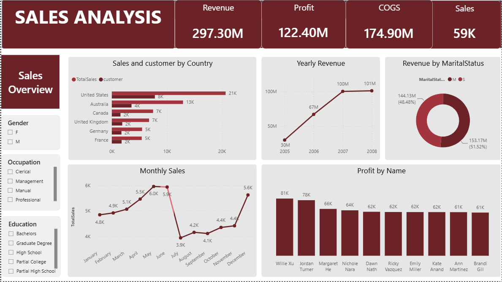

# Adventureworks-sales-dashboard

## Project Overview

An interactive two-page Power BI dashboard analysing sales, profit and customer behaviour for the AdventureWorks sample company (July 2005 to July 2008).

## Business questions
- How much revenue and profit does the business make, and how has it changed over time?
- Which countries, products and customers drive the most sales and profit?
- Which customer groups (gender, occupation, education, marital status) contribute most?

## Dataset
Microsoft's AdventureWorks sample data, supplied as one Excel workbook with six tables:

| Table | Rows | Purpose |
|---|---|---|
| SalesTable | 58,798 | One row per order line (quantity, unit price, cost, dates) |
| Customer | 18,384 | Demographics: gender, marital status, occupation, education |
| Product | 606 | Product names, colour, size, cost |
| Territory | 12 | Sales territory and country |
| Geography | 656 | City, state and country lookup |
| Date | 2,191 | Calendar table |

## Key figures
| Measure | Value | Definition |
|---|---|---|
| Revenue | 297.30M | OrderQuantity × UnitPrice |
| COGS | 174.90M | OrderQuantity × ProductStandardCost |
| Profit | 122.40M | Revenue − COGS (41.2% margin) |
| Sales | 59K | Count of order lines |

## Dashboard pages
**Sales Overview:** KPI cards, sales and customers by country, yearly revenue, revenue by marital status, monthly sales, and top 10 customers by profit.

**Sales Analysis:** a monthly matrix that drills down to country (revenue, profit, cost of goods), and a profit-by-product chart. Both pages have slicers for gender, occupation and education.

## Findings
- Revenue grew from 29.9M (2005, July to December only) to 66.8M in 2006 and 99.8M in 2007. 2008 (January to July) is already at 100.7M.
- May and June are the strongest months for revenue; August and September are the weakest.
- The United States has the most sales transactions, but Australia has the highest revenue (93.5M vs 92.1M).
- Mountain-200 Black (size 46) is the most profitable product at about 6.6M.
- Married customers account for 51.5% of revenue.

## Data preparation
Cleaned in Power Query before modelling:
- Removed unnecessary and personal columns from the Customer table: AddressLine, NumberCarsOwned and HouseOwnerFlag.
- Removed the Spanish and French duplicates of the occupation and education columns, keeping the English versions.
- Renamed EnglishOccupation to Occupation (and EnglishEducation to Education) so the slicers are clear.

## Tools
Excel, Power Query, Power BI, DAX

## Notes
- Data source: Microsoft AdventureWorks sample data (fictitious company).
- Revenue is calculated as quantity × unit price, so it differs from the SalesAmount column in the source table (28.41M).

## Repository contents 
* [AdventureWorks Dataset](Power-BI-Project-AdventureWorksxlsx)
* [PowerBI Project file](Adventureworks-sales-dashboard)
* [Sales Overview Dashboard](Sales-Overview.png)
* [Sales Analysis Dashboard](Sales-Analysis.png)
* README.md - Project documentation
